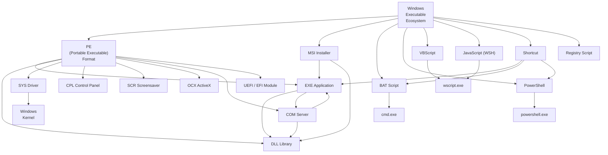

    

        
    

# **`Awesome`** [PE](https://wikipedia.org/wiki/Portable_Executable) (_Portable Executable_) [Feature](https://wikipedia.org/wiki/Feature_(machine_learning)) [Extractor](https://wikipedia.org/wiki/Comparison_of_executable_file_formats) 

    
    &nbsp;
    
    &nbsp;
    
    

## 📖 Contents
- [My Other Awesome Lists](#my-other-awesome-lists)
- [Contributing](#contributing)
- [Contributors](#contributors)

## Online Tools
- [Manalyze](https://github.com/JusticeRage/Manalyze) - A static [analyzer](https://manalyzer.org/) for PE executables.

### My Other Awesome Lists
You can access the my other awesome lists [here](https://cyberthreatdefence.com/my_awesome_lists)

### Contributing
[Contributions of any kind welcome, just follow the guidelines](contributing.md)!

### Contributors
[Thanks goes to these contributors](https://github.com/cybersecurity-dev/awesome-pe-feature-extractor/graphs/contributors)!

### License

[🔼 Back to top](#awesome-pe-feature-extractor-)
